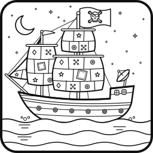

# Patchwork

[![Actions Status][actions-badge]][actions-link]
[![Documentation Status][rtd-badge]][rtd-link]
[![PyPI version][pypi-version]][pypi-link]
[![PyPI platforms][pypi-platforms]][pypi-link]
[![Coverage][coverage-badge]][coverage-link]

<!-- SPHINX-START -->

<!-- prettier-ignore-start -->
[actions-badge]:            https://github.com/flint-crew/patchwork/workflows/CI/badge.svg
[actions-link]:             https://github.com/flint-crew/patchwork/actions
[pypi-link]:                https://pypi.org/project/askap-patchwork/
[pypi-platforms]:           https://img.shields.io/pypi/pyversions/askap-patchwork
[pypi-version]:             https://img.shields.io/pypi/v/askap-patchwork
[rtd-badge]:                https://readthedocs.org/projects/patchwork/badge/?version=latest
[rtd-link]:                 https://patchwork.readthedocs.io/en/latest/?badge=latest
[coverage-badge]:           https://codecov.io/github/flint-crew/patchwork/branch/main/graph/badge.svg
[coverage-link]:            https://codecov.io/github/flint-crew/patchwork

<!-- prettier-ignore-end -->

The pirate quilt!

patchwork is a Python library and set of command-line tools for linear
mosaicking of radio images. Each image is resampled onto a common pixel grid,
weighted by its primary beam and its noise, and added to the mosaic. The images
can first be convolved to a common restoring beam.

The library uses numpy and astropy, and a separate pipeline runs the same steps
on a dask cluster.



## Documentation

The documentation is on [Read the Docs](https://patchwork.readthedocs.io/).

## Usage

```bash
# Convolve a set of beam images to their common restoring beam and mosaic
# them, weighting by a Gaussian primary beam and their noise
patchwork mosaic beam*.fits --convolve natural --output-base field

# Or only convolve them, writing beam*.conv.fits
patchwork convolve beam*.fits

# Or rotate Q and U cubes referenced to north at the boresight to north at each
# pixel, writing beam*.rot.fits with their frame recorded in the header
patchwork rotate beam*.{q,u}.fits --frame-centre 12.5 -81.0

# Mosaic Stokes I, Q and U together, rotating Q and U into the frame of the
# mosaic and removing the leakage of Stokes I with an ASKAP holography cube
patchwork mosaic beam*.{i,q,u}.fits --remove-leakage \
    --pb-model holography --holography-cube akpb.iquv.cube.fits \
    --frame-centre 12.5 -81.0 --output-base field

# Cubes are mosaicked in the same way, here each with its weights log, and
# every channel convolved to a common beam first, in eight processes
patchwork mosaic beam*.{i,q,u}.cube.fits --weights beam*.{i,q,u}.weights.txt \
    --frame-centre 12.5 -81.0 --convolve natural --output-base field \
    --max-workers 8 --processes

# patchwork-pipeline takes the same arguments, and spreads the work over a
# dask cluster: a local one, or one described in a YAML file
patchwork-pipeline beam*.{i,q,u}.cube.fits --weights beam*.{i,q,u}.weights.txt \
    --frame-centre 12.5 -81.0 --convolve natural --output-base field \
    --cluster-config slurm.yaml
```

`patchwork` runs on one machine, with `--max-workers` threads, or processes with
`--processes`, and does not use dask. `patchwork-pipeline` does the same work,
convolution included, on a dask cluster.

Images and cubes are given as one list: each one's Stokes parameter is read from
its header, and those on one pixel grid are taken to be one beam. The mosaics
are labelled by Stokes parameter, such as `field.i.mosaic.fits` and
`field.qu.weight.fits`, or `field.i.cube.fits` for cubes.

Two dependencies are optional: numba, which speeds up the resampling, and zarr,
which is needed for zarr output.

```bash
pip install "askap-patchwork[numba,zarr]"
```

## Installation

Releases are on PyPI:

```bash
# PyPI release
pip install askap-patchwork
```

To install the latest commit from GitHub:

```bash
# Direct git install (latest push)
pip install git+https://github.com/flint-crew/patchwork.git
```

Or from a local clone:

```bash
git clone https://github.com/flint-crew/patchwork.git
cd patchwork
pip install -e .
```

With [uv](https://docs.astral.sh/uv/), `uv sync` installs the versions pinned in
`uv.lock`:

```bash
git clone https://github.com/flint-crew/patchwork.git
cd patchwork
uv venv
uv sync
```

## Contributions

Report problems and propose changes through GitHub issues and pull requests.

To install the development tools:

```bash
git clone https://github.com/flint-crew/patchwork.git
cd patchwork
pip install -e . --group dev  # --group needs pip 25.1 or newer
```

Or, using `uv`:

```bash
git clone https://github.com/flint-crew/patchwork.git
cd patchwork
uv sync --group dev
```
